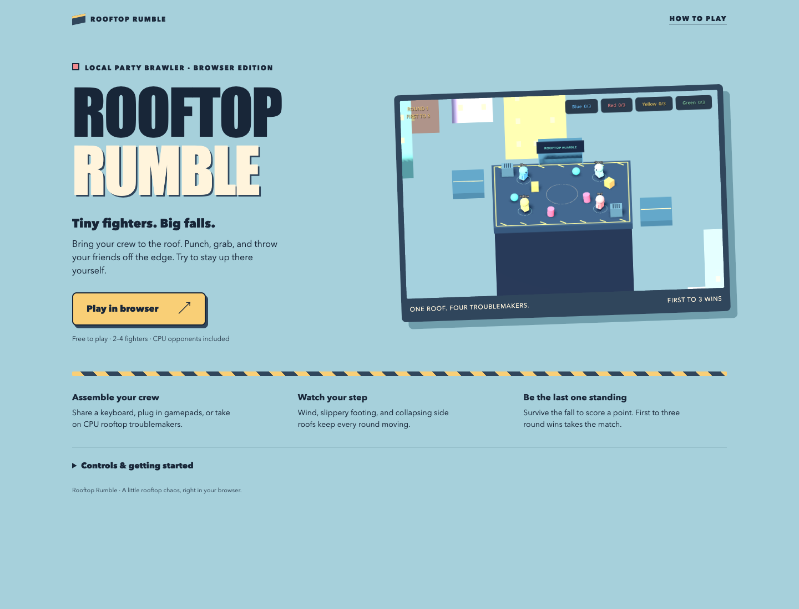

# Rooftop Rumble

A browser-first 3D party brawler for 2–4 fighters, built with Godot and GDScript. Punch, shove, drag, and throw your friends off a rooftop while wind, slippery footing, and collapsing side roofs make staying upright harder. All meshes, UI, impact effects, and short sound effects are generated in code; no asset packs or paid dependencies are required.

## Play in your browser

The first release targets desktop browsers with WebGL 2. Play solo against CPU opponents, share a keyboard with a friend, or connect controllers for up to four local fighters. Players share one computer; online multiplayer and touch controls are not included.

```sh
npm install
npm run build
npm run dev
```

Open the local URL printed by the server and choose **Play in browser**. Click inside the game for keyboard focus. Press a controller button before opening player setup so the browser can discover it. The first build downloads the pinned Godot engine and web template into ignored `.tools/`; subsequent builds reuse them. Node.js 22+, `curl`, and `unzip` are required. Native Godot installation is optional for web builds.

## Deploy to Vercel

1. Import [PuvaanRaaj/rooftop-rumble](https://github.com/PuvaanRaaj/rooftop-rumble) as a new Vercel project.
2. Use the repository root and **Other** framework preset.
3. The committed `vercel.json` sets **Build Command** to `npm run build` and **Output Directory** to `dist`.
4. Deploy. No environment variables or backend services are needed.

Vercel builds the Godot export from source; generated engine binaries and `dist/` are not committed. The export uses a single thread, so COOP/COEP headers are unnecessary. Large initial engine downloads may take a moment on slow connections. See [Vercel's configuration reference](https://vercel.com/docs/project-configuration/vercel-json) and [Godot's web export guide](https://docs.godotengine.org/en/4.5/tutorials/export/exporting_for_web.html).

## Native launch (optional)

On this Mac, double-click `Launch Rooftop Rumble.command` to use the included local engine.

1. Install **Godot 4.5 or newer**, standard edition, from [godotengine.org](https://godotengine.org/download/). The .NET edition is unnecessary.
2. Open Godot's Project Manager, choose **Import**, and select this directory's `project.godot`.
3. Open the project and press **F5** to run it. **F6** runs the currently open scene; open `scenes/main.tscn` first. On a Mac, your keyboard settings may require the Fn key.
4. Choose **Let's Rumble**, select 2–4 fighters, assign input sources, and choose **Start Match**.

Alternatively, with Godot on your PATH:

```sh
godot --path .
```

Godot's Compatibility renderer is configured. Native builds target macOS, Windows, and Linux; the browser export is configured separately in `export_presets.cfg`. Native platform export binaries are not included. Install Godot export templates and use its Export dialog to package a standalone app.

## Controls

| Action | Keyboard 1 | Keyboard 2 | Gamepad |
|---|---|---|---|
| Move | WASD | Arrow keys | Left stick |
| Jump / struggle out of a grab | Space | Right Shift | A / bottom face button |
| Punch | F | K | X / left face button |
| Shove / throw held fighter or object | G | L | B / right face button |
| Grab / pick up / throw | E | Enter | Y / top face button |
| Return to main menu | Escape | Escape | Keyboard Escape |

Left Shift is also accepted for Keyboard 2. Controller face buttons use Godot's standard gamepad mapping; printed symbols vary by controller. Connect controllers **before opening player setup**. Each keyboard layout and controller can join once; multiple CPU opponents are allowed. The default crew is Keyboard 1 and one CPU.

Face a nearby target to punch, shove, or grab. Tap Grab to pick up a fighter or prop, then tap again to throw with a visible wind-up and follow-through. Shove also throws while holding. Punch breaks a grab when fighting back; it does not throw your held target. Carrying slows movement. Repeated jump or punch inputs help a grabbed fighter escape, and grabs expire automatically.

## Rules

- Stay on the main roof or jump to the smaller side roofs. Falling below the rooftop eliminates you for that round.
- The last fighter alive earns one point. A near-simultaneous total knockout is a draw and awards no point.
- First to **three round wins** wins the match. Choose **Next Round**, **Play Again**, or **Main Menu** from the result screen.
- Hazards begin every 20 seconds: a 2.5-second warning precedes 5.5 seconds of wind, slippery movement, or one collapsing side roof. Platforms and props reset between rounds.
- After two minutes, increasing outward force discourages indefinite standoffs.

## Automated checks

Run these from the project directory, replacing `godot` with your installed Godot executable if it is not on PATH:

```sh
godot --headless --path . --editor --import --quit
godot --headless --path . --script tests/test_match.gd
godot --headless --path . --script tests/test_gameplay.gd
godot --headless --path . --fixed-fps 60 --script tests/test_throw.gd
godot --headless --path . --fixed-fps 60 --script tests/test_props.gd
godot --path . --script tests/test_input.gd
godot --headless --path . --fixed-fps 60 --script tests/test_bots.gd
godot --headless --path . --quit-after 120
```

The match suite checks continuing rounds, draws, scoring, and the three-win threshold. The integrated suite drives the actual main scene through countdown, independent movement using injected input, combat/cooldowns, grabs and escape, prop pickup/throw/impact, hazard activation/reset, elimination, a full match, replay, and menu return. It calls hazard activation directly; it does not prove the full timed warning presentation or physical controller input. Successful tests print `PASS` and exit normally; engine errors still need investigation.

The native input suite uses synthetic physical key events; it does not prove hardware rollover. The CPU suite simulates a complete four-fighter match. Headless runs skip sound generation.

## Manual playtest checklist

1. Assign Keyboard 1 and Keyboard 2. Move both simultaneously and trigger each action independently. Check keyboard rollover with multiple movement/action keys held.
2. Connect controllers, reopen setup, and assign up to four fighters. Confirm each device moves only its assigned fighter and duplicate input assignments are rejected.
3. Punch and shove near every edge. Confirm readable hit effects, brief stun, reliable elimination, and no interference from eliminated fighters.
4. Grab a fighter, drag, tap Grab again to throw, and escape with repeated jump/punch. Pick up each prop type and throw it with Grab or Shove; check wind-up, release, spin, collisions, and crate breakage.
5. Survive past 20 seconds repeatedly. Watch warning messages, test wind/sliding, leave a red shaking side roof before collapse, and confirm it returns.
6. Complete three wins, replay the match, and return to the menu during play. Confirm fresh scores, fighters, platforms, and props.

## Current limitations

- Controller hardware behavior, simultaneous physical keyboard input, sound output, and human judgments of movement/combat feel require manual verification. Automated injected input does not establish those results.
- CPU opponents use short committed plans, prop pickup/throws, and basic edge avoidance. They can still fall, and do not plan complex gap traversal or prop strategies.
- Characters use stable kinematic movement and a timed grab tether, rather than full ragdolls. Picking up a prop freezes it until release.
- One arena, no online play, no progression, no controller-driven menu navigation guarantee, and no background music. Procedural sound effects share one audio player.
- Wind has directional text arrows and physical force; richer weather visuals would improve readability.

High-value follow-ups are a friends-and-controllers playtest, tuning knockback and grab escape from that feedback, richer weather visuals, improved CPU movement around obstacles, and platform exports.

See [GAME_DESIGN.md](GAME_DESIGN.md) for tuning and [ARCHITECTURE.md](ARCHITECTURE.md) for implementation trade-offs.

## Mac quick launch

Double-click `Launch Rooftop Rumble.command`. This workspace includes an official Godot 4.5.2 runtime in ignored `.tools/`; it is not committed with the project. The launcher also supports `/Applications/Godot.app` or `godot` on PATH. When sharing the source, friends can install Godot from the official download page and import `project.godot`.

## Validation performed

Godot 4.5.2 editor import and headless scene launch passed. The rules suite passed and the integrated physics suite passed 25 checks with no engine errors. Native synthetic keyboard input verified simultaneous layouts and action edges. An actual OpenGL frame rendered on Apple M2 and was inspected (`docs/arena-preview.png`). Physical gamepads and two-person keyboard rollover have not been tested.


### Browser release verification

The single-thread web export loaded in Chromium 151 using WebGL 2 with no console errors. Browser interaction reached crew setup, started a keyboard-versus-CPU round, accepted movement/action keys, showed a round result, and returned to the menu with Escape. The landing page had no horizontal overflow at a 390-pixel viewport. These synthetic browser inputs do not verify physical keyboard rollover, controllers, sound quality, or other browsers.

A clean Ubuntu GitHub Actions build downloaded the pinned Linux Godot engine and verified web template, then exported successfully. Check the [browser build workflow](https://github.com/PuvaanRaaj/rooftop-rumble/actions/workflows/web-build.yml) for the latest commit. The Vercel hosting configuration is prepared; a Vercel deployment has not been created.




### Closer cartoon presentation

The camera now shows fighters and the main roof roughly one-third larger at the standard 16:10 size, while adapting to keep the side roofs visible. Fighter faces/clothing, roof panels, facade windows, vents, and signage have more detail. The browser embed retains its game aspect ratio at narrower widths and the viewport expands for fullscreen. This visual pass preserves the current playable arena dimensions and combat controls.


### Animated throws and interactive props

Tap **E / Enter / gamepad Y** to grab, then tap again to throw. A direction arrow and THROW prompt show what to do while carrying. The fighter draws the object back, releases it into a spinning physical arc, and follows through; **G / L / gamepad B** remains a throw shortcut. Hits, escapes, and round/menu transitions cancel unfinished throws.

The roof now has eight props: wooden crates that break into fading shards after thrown impacts, heavier metal barrels that roll and tumble, and colorful beach balls with stronger bounce. Props reset between rounds. Automated throw and prop suites cover timing, cancellation, physical flight, bounce, impact safety, and cleanup.

Native validation passed 20 animated-throw checks, 17 prop checks, 25 gameplay checks, and a full four-CPU match. The exported game loaded and completed browser menu/match/input checks without console errors. Carry, wind-up, and release snapshots are saved under `docs/throw-*.png`.


### Natural CPU decisions

CPU fighters use the same movement speed and combat rules as the player. They pause to assess, pursue a prop or opponent, prepare one action, commit to its direction, and recover or reposition. Their aim is imperfect and their plan uses a recent target position, so dodges can make attacks and throws miss. They can pick up real props and throw them through the same animation as human players.

This is a lightweight game AI with varied decisions; human playtesting is still needed to tune how natural it feels. A difficulty selector is not included.
